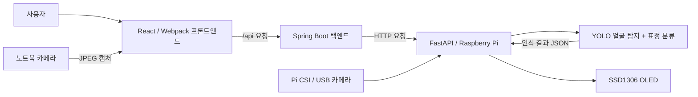

# FaDO

**FaDO**는 카메라 기반 얼굴·표정 인식과 픽셀 표정 편집 기능을 결합해, 인식하거나 선택한 표정을 **Raspberry Pi의 128 × 64 OLED 디스플레이**에 표현하는 프로젝트입니다.

웹에서 기본 표정을 선택하거나 새로운 픽셀 표정을 만들 수 있습니다. 카메라 인식 모드에서는 얼굴을 탐지하고 표정을 분류한 뒤, 해당 표정의 PNG를 저장하고 OLED에 표시합니다.

이 문서는 **프로젝트 소개**와 함께, 새로운 개발 환경에서 FaDO를 설치하고 실행하며 문제를 해결하기 위한 **설치·운영 매뉴얼**을 제공합니다.

## 목차

1. [프로젝트 소개](#1-프로젝트-소개)
2. [주요 기능](#2-주요-기능)
3. [시스템 아키텍처](#3-시스템-아키텍처)
4. [기술 스택 및 요구 환경](#4-기술-스택-및-요구-환경)
5. [프로젝트 구조](#5-프로젝트-구조)
6. [설치 및 개발 환경 구성](#6-설치-및-개발-환경-구성)
7. [AI 모델 준비 및 NCNN 변환](#7-ai-모델-준비-및-ncnn-변환)
8. [환경 변수 및 서버 연결](#8-환경-변수-및-서버-연결)
9. [실행 및 운영](#9-실행-및-운영)
10. [API 명세](#10-api-명세)
11. [사용 방법](#11-사용-방법)
12. [테스트 및 장애 대응](#12-테스트-및-장애-대응)
13. [배포 및 저장소 관리](#13-배포-및-저장소-관리)
14. [라이선스](#14-라이선스)

## 1. 프로젝트 소개

FaDO는 **표정 인식(AI) → 결과 전달(API) → 픽셀 표정 표현(OLED)**을 하나의 서비스로 연결합니다.

사용자는 웹에서 표정을 직접 선택하거나 128 × 64 픽셀 편집기로 원하는 표정을 제작할 수 있습니다. 또한 **노트북 카메라**와 **Raspberry Pi 카메라** 중 입력 장치를 선택하여 표정을 인식하고 OLED에 표시할 수 있습니다.

얼굴 사진 자체를 OLED에 출력하는 것이 아니라, 인식된 표정에 대응하는 **128 × 64 흑백 PNG**를 OLED에 표시합니다. 카메라 예측값은 실제 감정을 확정하는 정보가 아닌 모델의 분류 결과입니다.

## 2. 주요 기능

| 기능 | 설명 |
| --- | --- |
| 표정 선택 | 기본 표정 선택 및 OLED 표시 |
| 픽셀 편집기 | 사용자 정의 128 × 64 표정 제작·수정·내보내기 |
| 표정 라이브러리 | 기본/사용자 표정 검색·관리 |
| 얼굴 탐지 | YOLO 기반 얼굴 위치 검출 |
| 표정 분류 | `angry`, `happy`, `neutral`, `sad`, `surprised` 분류 |
| 카메라 선택 | 노트북 카메라 또는 Raspberry Pi의 CSI/USB 카메라 선택 |
| 카메라 미리보기 | 인증된 사용자의 Raspberry Pi 카메라 영상 스트리밍 |
| 자동 OLED 표시 | 조건에 맞는 표정이 연속 인식되면 PNG 저장 후 OLED 전송 |
| 장치 연결 확인 | Raspberry Pi API 상태 확인 및 프론트엔드 표시 |

> 기본 표현에 `love`가 포함되어 있지만, 현재 AI 표정 분류 클래스는 위 5개입니다. `love`는 수동 선택용 표정으로 사용할 수 있습니다.

## 3. 시스템 아키텍처



### 실행 경로별 동작

**노트북 카메라 인식**

1. 브라우저에서 카메라 접근 권한을 받은 뒤 JPEG를 캡처합니다.
2. `POST /api/v1/detect` → Spring Boot → `POST /yolo/predict`로 전달합니다.
3. Raspberry Pi에서 얼굴 탐지·표정 분류를 수행하고 결과를 반환합니다.
4. 자동 표시 모드에서 조건을 만족하면 PNG 저장 → OLED 표시 API를 순서대로 호출합니다.

**Raspberry Pi 카메라 인식**

1. 웹에서 라파 카메라를 선택하고 인식 테스트 또는 자동 표시를 시작합니다.
2. `POST /api/v1/raspberry/camera/detect` → Spring Boot → `POST /camera/detect`로 요청합니다.
3. Raspberry Pi가 CSI/USB 카메라의 새 프레임을 추론하고 결과를 반환합니다.
4. 웹에서 표정이 확정되면 기본 표정 PNG를 저장하고 OLED에 표시하도록 요청합니다.

**카메라 영상 스트림**은 `/camera/stream` 요청이 있을 때만 전송됩니다. **웹의 자동 인식 루프** 역시 사용자가 시작했을 때 동작합니다. 따라서 FastAPI 서비스를 켜 두는 것만으로 OLED가 계속 자동 변경되지는 않습니다.

## 4. 기술 스택 및 요구 환경

| 영역 | 기술 / 환경 |
| --- | --- |
| Frontend | React 19, JavaScript/JSX, Webpack 5, CSS |
| Backend | Java 21, Spring Boot 4, Gradle |
| AI / API | Python 3.13.5, FastAPI, Ultralytics YOLO, OpenCV |
| Raspberry Pi 추론 | NCNN, CPU |
| 카메라 | 노트북 웹캠 또는 Raspberry Pi CSI/USB 카메라, Picamera2/libcamera(CSI) |
| 출력 장치 | Raspberry Pi 4, SSD1306 SPI OLED(128 × 64) |
| 서비스 운영 | Gunicorn + Uvicorn worker, systemd, Nginx(사용 시) |

- **Node.js:** 프론트엔드는 Node.js 24 환경에서 검증되었습니다.
- **Java:** `Backend/build.gradle`의 Java toolchain은 21입니다.
- **Python:** 프로젝트에서 사용한 기준 버전은 3.13.5입니다.
- **카메라/디스플레이:** 실제 하드웨어 제어는 Raspberry Pi에서만 수행합니다.

## 5. 프로젝트 구조

아래 트리는 제공된 실제 디렉터리에서 **주요 소스·설정만 발췌**한 것입니다. `node_modules/`, `dist/`, `build/`, `__pycache__/`, 학습 이미지 수천 장 등은 가독성을 위해 생략했습니다.

```text
FaDO/
├── Backend/
│   ├── src/main/java/backend/server/
│   │   ├── BackendApplication.java
│   │   ├── RaspberryPi/
│   │   │   ├── API/
│   │   │   │   ├── CameraController.java
│   │   │   │   ├── CameraPreviewController.java
│   │   │   │   ├── DetectionController.java
│   │   │   │   ├── DeviceController.java
│   │   │   │   ├── ExpressionImageController.java
│   │   │   │   └── RaspberryHealthController.java
│   │   │   ├── DTO/
│   │   │   └── RaspberryClient.java
│   │   └── health/
│   ├── src/main/resources/
│   │   ├── application.properties
│   │   └── application.properties.sample
│   ├── gradle/wrapper/
│   ├── build.gradle
│   ├── gradlew
│   └── gradlew.bat
├── Frontend/
│   ├── public/
│   ├── css/
│   ├── src/
│   │   ├── components/
│   │   ├── context/
│   │   ├── core/
│   │   │   └── expressionRecognition.js
│   │   ├── features/
│   │   ├── hooks/
│   │   ├── pages/
│   │   │   ├── studio/
│   │   │   ├── library/
│   │   │   ├── settings/
│   │   │   └── guide/
│   │   ├── services/
│   │   ├── App.jsx
│   │   └── main.jsx
│   ├── tests/
│   ├── package.json
│   ├── package-lock.json
│   ├── webpack.config.dev.js
│   └── webpack.config.prod.js
├── RPiServer/
│   ├── main.py                  # FastAPI 진입점
│   ├── camera_stream.py         # Pi 카메라 인증·스트림·인식
│   ├── yolo_api.py              # 업로드 이미지 얼굴/표정 추론
│   ├── Cam_test_Rpi.py          # Pi 카메라 독립 테스트
│   ├── Cam_test.py
│   ├── models/
│   │   ├── face_detector.pt
│   │   ├── expression.pt
│   │   ├── face_detector_ncnn_model/
│   │   └── expression_ncnn_model/
│   ├── expressions/            # Pi 측 표정 PNG
│   └── YoloTrain/              # 학습 데이터 및 실행 기록
├── RaspberryPi/
│   ├── ImgTest.py               # OLED 정적 이미지 출력
│   ├── GifTest.py
│   ├── Emotion.py
│   └── main.py
├── uploads/expressions/         # Backend 측 표정 PNG
├── requirements_window.txt
├── requirements_raspberryPi.txt
└── README.md
```

`RPiServer/main.py`는 **웹 API 서버**이고, `RaspberryPi/main.py`는 별도의 **하드웨어 관련 스크립트**입니다. 이름이 같아도 실행 목적이 다릅니다.

## 6. 설치 및 개발 환경 구성

모든 명령은 별도 안내가 없으면 **FaDO 프로젝트 루트**에서 실행합니다.

### 6.1. 저장소 복제

```bash
git clone https://github.com/Jo-DanYeong/FaDO.git
cd FaDO
```

### 6.2. Python 가상환경

```bash
python -m venv .venv
```

Windows PowerShell:

```powershell
.\.venv\Scripts\Activate.ps1
```

Raspberry Pi / Linux / macOS:

```bash
source .venv/bin/activate
```

Python 버전 확인:

```bash
python --version
```

> Windows와 Raspberry Pi는 각각 자신의 장치에 `.venv`를 생성합니다. 두 장치에서 가상환경 폴더를 복사하여 공유하지 않습니다.

### 6.3. Python 패키지 설치

Windows:

```powershell
python -m pip install -r requirements_window.txt
```

Raspberry Pi:

```bash
python -m pip install -r requirements_raspberryPi.txt
```

각 운영체제에 맞는 requirements 파일만 설치하세요.

> **Windows CUDA 주의:** 현재 `requirements_window.txt`에는 CUDA 12.8용 PyTorch 패키지가 지정되어 있습니다. NVIDIA CUDA를 사용할 수 없는 Windows PC에서는 해당 설정이 적합하지 않을 수 있으므로 CPU용 PyTorch 환경을 별도로 준비해야 합니다. Raspberry Pi 전용 GPIO·libcamera 의존성을 Windows에 그대로 설치하면 안 됩니다.

### 6.4. Raspberry Pi 카메라 시스템 패키지

Raspberry Pi OS에서 CSI 카메라를 사용한다면 다음을 준비합니다.

```bash
sudo apt update
sudo apt install -y python3-picamera2 python3-libcamera
```

카메라 자체 점검:

```bash
rpicam-hello
```

Python 접근 점검:

```bash
python -c "from picamera2 import Picamera2; print('Picamera2 OK')"
```

`ModuleNotFoundError: No module named 'libcamera'`가 발생하면 **시스템 Python과 `.venv` Python 버전**을 먼저 비교하세요. Raspberry Pi OS가 제공하는 시스템 패키지의 Python 버전과 가상환경 Python 버전이 다르면 `include-system-site-packages = true`만으로 해결되지 않을 수 있습니다. 정상 동작 중인 YOLO 가상환경을 바로 삭제하지 마세요.

### 6.5. Spring Boot 환경

Java 21을 설치하고 버전을 확인합니다.

```bash
java -version
```

프로젝트는 Gradle Wrapper를 포함합니다. 별도의 전역 Gradle 설치는 필수가 아닙니다.

Windows PowerShell:

```powershell
cd Backend
.\gradlew.bat bootRun
```

Linux/macOS:

```bash
cd Backend
./gradlew bootRun
```

Linux/macOS에서 실행 권한이 없으면 `chmod +x ./gradlew`를 먼저 실행합니다.

### 6.6. 프론트엔드 환경

```bash
cd Frontend
npm ci
npm start
```

- 개발 화면: `http://127.0.0.1:3000/#studio`
- 설정 화면: `http://127.0.0.1:3000/#settings`
- 개발 프록시: `Frontend/webpack.config.dev.js`의 `/api` → `http://127.0.0.1:8080`

프론트엔드 관련 추가 설명은 [`Frontend/README.md`](Frontend/README.md)를 참고하세요.

## 7. AI 모델 준비 및 NCNN 변환

FaDO는 서로 다른 역할의 두 YOLO 모델을 연결합니다.

1. **얼굴 탐지 (`face_detector`)**: 사진에서 얼굴의 바운딩 박스를 찾습니다.
2. **표정 분류 (`expression`)**: 얼굴 영역을 잘라 다섯 표정 중 하나로 분류합니다.

### 7.1. 모델 배치

```text
RPiServer/models/
├── face_detector.pt
├── expression.pt
├── face_detector_ncnn_model/
│   ├── model.ncnn.param
│   ├── model.ncnn.bin
│   └── metadata.yaml
└── expression_ncnn_model/
    ├── model.ncnn.param
    ├── model.ncnn.bin
    └── metadata.yaml
```

NCNN 모델은 단일 파일이 아니라 **폴더 전체**가 필요합니다. 모델 가중치 파일을 저장소에 포함하지 않았다면 운영 장비에 별도로 전달해야 합니다.

### 7.2. NCNN 변환

`.pt` 모델이 준비된 환경에서, 프로젝트 루트 기준으로 실행합니다.

```bash
python -c "from ultralytics import YOLO; YOLO('RPiServer/models/face_detector.pt').export(format='ncnn', imgsz=416, device='cpu')"
python -c "from ultralytics import YOLO; YOLO('RPiServer/models/expression.pt').export(format='ncnn', imgsz=160, device='cpu')"
```

### 7.3. 모델 설정 및 점검

`RPiServer/yolo_api.py`는 기본적으로 NCNN 폴더를 사용합니다.

```ini
FADO_MODEL_FORMAT=ncnn
```

원본 `.pt` 모델로 시험하려면 `FADO_MODEL_FORMAT=pt`를 사용할 수 있습니다. 다만 **카메라 스트리밍 코드는 NCNN 폴더를 직접 참조**하므로, 카메라 기능까지 함께 사용할 때는 NCNN 모델 폴더가 필요합니다.

```bash
curl http://127.0.0.1:8000/yolo/model-info
```

`pipeline`이 `face-expression`인지 확인하세요. 이 응답의 `loaded` 필드는 모델이 실제로 메모리에 로드됐는지 나타내며, 처음에는 `false`일 수 있습니다.

## 8. 환경 변수 및 서버 연결

### 8.1. Spring Boot → Raspberry Pi 연결

`Backend/src/main/resources/application.properties.sample`을 참고해 `application.properties`를 구성합니다.

```properties
spring.application.name=Backend
Raspberry.base-url=http://<PI_HOST_OR_PROXY>
Raspberry.camera-user=${FADO_CAMERA_USER:}
Raspberry.camera-password=${FADO_CAMERA_PASSWORD:}
```

- `Raspberry.base-url`은 **Spring Boot 실행 장치에서 도달할 수 있는** Raspberry Pi API 또는 Nginx 리버스 프록시 주소입니다.
- FastAPI가 `127.0.0.1:8000`에만 바인딩되어 있다면 외부 장치에서 직접 접근할 수 없습니다. Raspberry Pi의 Nginx/Tailscale 등 실제 네트워크 구성을 확인하세요.
- `FADO_CAMERA_USER`와 `FADO_CAMERA_PASSWORD`는 **Java 프로세스 환경에도 별도로** 등록해야 합니다.
- 개발 프론트엔드의 `/api` 프록시는 Spring Boot 주소를 가리킵니다. 브라우저에서 Pi 내부 주소를 직접 하드코딩할 필요가 없습니다.

### 8.2. Raspberry Pi 카메라 API 인증

서비스용 환경 파일 예시:

```bash
sudo nano /etc/fado-camera.env
```

```ini
FADO_CAMERA_KIND=csi
FADO_CAMERA_INDEX=0
FADO_CAMERA_USER=<CAMERA_API_USERNAME>
FADO_CAMERA_PASSWORD=<LONG_UNIQUE_PASSWORD>
FADO_MODEL_FORMAT=ncnn
```

USB 웹캠을 사용할 경우 `FADO_CAMERA_KIND=usb`로 변경합니다.

```bash
sudo chmod 600 /etc/fado-camera.env
sudo systemctl edit fado-fastapi
```

systemd 편집기에 다음을 추가합니다.

```ini
[Service]
EnvironmentFile=/etc/fado-camera.env
```

```bash
sudo systemctl daemon-reload
sudo systemctl restart fado-fastapi
```

**주의:** SSH 터미널에서 `export`한 환경 변수는 systemd로 실행 중인 기존 서비스에 자동 반영되지 않습니다. Java와 Pi에 설정된 사용자명·비밀번호는 같아야 합니다. 프론트엔드 소스, Git, localStorage 등에 비밀번호를 저장하지 마세요. HTTP Basic 인증을 공개 인터넷에서 사용해야 한다면 HTTPS와 접근 제한을 적용하세요.

## 9. 실행 및 운영

### 9.1. 권장 실행 순서

1. Raspberry Pi의 카메라·NCNN·OLED 장치를 점검합니다.
2. Raspberry Pi FastAPI 서비스를 실행합니다.
3. Windows 등의 개발 PC에서 Spring Boot를 실행합니다.
4. 프론트엔드 개발 서버를 실행합니다.
5. `/health`와 웹 화면에서 연결 상태를 확인합니다.

### 9.2. FastAPI 직접 실행 — 개발용

프로젝트 루트에서 `.venv` 활성화 후:

```bash
python -m uvicorn RPiServer.main:app --host 127.0.0.1 --port 8000 --workers 1
```

### 9.3. FastAPI systemd 서비스 — 운영용

FaDO 배포 환경에서 사용하는 서비스 이름은 `fado-fastapi`입니다.

```bash
sudo systemctl start fado-fastapi
sudo systemctl stop fado-fastapi
sudo systemctl restart fado-fastapi
sudo systemctl status fado-fastapi
```

서비스 설정 확인:

```bash
sudo systemctl cat fado-fastapi
```

실시간 로그:

```bash
sudo journalctl -u fado-fastapi -f
```

운영 서비스에는 **FastAPI 워커 1개**를 사용합니다. 여러 워커가 CSI 카메라와 OLED 하드웨어에 독립적으로 접근하면 충돌할 수 있습니다. 동일 포트에서 개발용 Uvicorn과 systemd 서버를 동시에 실행하지 마세요.

카메라 모듈 `camera_stream.py`를 별도 프로세스로 실행하지 않습니다. `RPiServer/main.py`가 라우터를 등록하며, 카메라는 스트림·인식 요청 시 사용됩니다.

### 9.4. Spring Boot 실행 및 빌드

Windows PowerShell:

```powershell
cd Backend
.\gradlew.bat bootRun
```

빌드:

```powershell
.\gradlew.bat build
```

> 카메라 기능을 사용한다면 실행 전에 Windows의 Java 실행 환경에 `FADO_CAMERA_USER`와 `FADO_CAMERA_PASSWORD`를 설정하세요. 실제 비밀번호를 커밋되는 `.properties` 파일에 직접 저장하지 않습니다.

### 9.5. 프론트엔드 실행 및 빌드

```bash
cd Frontend
npm ci
npm start
```

테스트 및 프로덕션 빌드:

```bash
npm test
npm run build
```

빌드 결과는 `Frontend/dist/`입니다. 운영 시 이 폴더의 정적 파일을 웹 서버에서 제공하고, 같은 사이트의 `/api` 요청을 Spring Boot로 전달해야 합니다.

## 10. API 명세

### 10.1. Raspberry Pi FastAPI

| Method | Endpoint | 설명 | 비고 |
| --- | --- | --- | --- |
| `GET` | `/health` | Pi API 상태 | 카메라 준비 상태와는 별개 |
| `GET` | `/yolo/model-info` | 모델 형식·분류 클래스 확인 | |
| `POST` | `/yolo/predict` | 업로드 JPEG/PNG 인식 | multipart `file` |
| `GET` | `/camera` | 카메라 미리보기 페이지 | Basic 인증 |
| `GET` | `/camera/stream` | MJPEG 영상 | Basic 인증 |
| `GET` | `/camera/status` | 카메라 상태 | Basic 인증 |
| `POST` | `/camera/detect` | Pi 카메라 프레임 인식 | Basic 인증 |
| `POST` | `/expression/image` | OLED용 128 × 64 PNG 저장 | multipart |
| `POST` | `/expression` | 저장된 PNG를 OLED에 표시 | JSON `expressionId` |
| `DELETE` | `/expression/image` | PNG 삭제 | query `expressionId` |

**얼굴·표정 인식 결과 예시** (`/camera/detect`):

```json
{
  "detections": [
    {"className": "happy", "confidence": 0.91, "box": [100, 80, 240, 260]}
  ]
}
```

실제 표정 및 신뢰도는 촬영 프레임에 따라 달라집니다.

**OLED 표시 요청 예시**:

```json
{"expressionId": "happy"}
```

### 10.2. Spring Boot — 프론트엔드에서 호출

| Method | Endpoint | 설명 |
| --- | --- | --- |
| `GET` | `/api/v1/raspberry/health` | Pi 연결 상태 확인 |
| `POST` | `/api/v1/detect` | 브라우저에서 업로드한 이미지 인식 |
| `POST` | `/api/v1/raspberry/camera/detect` | Pi 카메라 인식 요청 |
| `GET` | `/api/v1/raspberry/camera/stream` | Pi 카메라 영상 중계 |
| `POST` | `/api/v1/expression/image` | 표정 PNG 저장 |
| `DELETE` | `/api/v1/expression/image?expressionId=...` | 표정 PNG 삭제 |
| `POST` | `/api/v1/expression` | OLED 표정 선택 |

API의 세부 상태 코드와 요청·응답 DTO는 `Backend/src/main/java/backend/server/RaspberryPi/API/` 및 `DTO/`에서 관리합니다.

## 11. 사용 방법

### 기본 표정 및 사용자 표정

1. 웹의 **Studio** 화면에서 기본 표정을 선택합니다.
2. 사용자 표정을 만들려면 픽셀 편집기에서 128 × 64 이미지를 작성합니다.
3. 선택·저장 시 PNG 업로드가 완료된 뒤 OLED 표시 요청이 전달됩니다.
4. 사용자가 만든 표정은 **Library**에서 검색·수정·삭제·내보내기할 수 있습니다.

### AI 카메라 인식

1. **Settings** 또는 **Studio**에서 `노트북 카메라` 또는 `라파 카메라`를 선택합니다.
2. **카메라 인식 테스트**로 표정 결과를 먼저 확인합니다.
3. **OLED 자동 표시 시작**을 누르면 반복 인식을 시작합니다.
4. 동일한 표정이 기준을 충족하면 OLED에 해당 기본 표정을 표시합니다.
5. 자동 표시를 중지하거나 페이지를 이탈하면 브라우저의 다음 요청과 관련 자원을 정리합니다.

표정 판정 기준은 `Frontend/src/core/expressionRecognition.js`에서 관리하며, 현재 설명 기준은 **최소 신뢰도 55%, 동일 표정 2회 확인, 추론 후 750ms 간격**입니다. 실제 요청 주기는 추론 시간에 따라 더 길어질 수 있습니다. 얼굴이 검출되지 않거나 결과가 불확실하면 마지막 OLED 화면을 유지합니다.

## 12. 테스트 및 장애 대응

### 12.1. 연결·모델·카메라 확인

Raspberry Pi API:

```bash
curl -i http://127.0.0.1:8000/health
curl -i http://127.0.0.1:8000/yolo/model-info
```

카메라 인식 API(사용자명 예시 `fado`, 비밀번호는 터미널에 프롬프트로 입력):

```bash
curl -i -u fado -X POST http://127.0.0.1:8000/camera/detect
```

Pi CSI 카메라 독립 테스트(운영 서버 카메라 스트림과 **동시 실행하지 않음**):

```bash
python RPiServer/Cam_test_Rpi.py --camera csi --headless
```

USB 카메라:

```bash
python RPiServer/Cam_test_Rpi.py --camera usb --headless
```

OLED 정적 이미지 동작은 `RaspberryPi/ImgTest.py`와 실제 배선을 점검하세요.

### 12.2. 서비스 로그

```bash
sudo systemctl status fado-fastapi
sudo journalctl -u fado-fastapi -n 100 --no-pager
sudo journalctl -u fado-fastapi -f
```

Nginx를 사용하는 경우:

```bash
sudo tail -f /var/log/nginx/error.log
```

### 12.3. 자주 발생하는 문제

| 증상 | 원인 후보 / 확인할 부분 |
| --- | --- |
| `404 /camera/detect` | Pi `camera_stream.py`에 라우터가 있는지, `RPiServer/main.py`에 등록했는지 확인 |
| `404 /api/v1/raspberry/camera/detect` | Spring Boot의 `CameraController.java` 등록 및 재시작 확인 |
| `401 Unauthorized` | Pi와 Java의 카메라 API 사용자명·비밀번호 불일치 |
| `503 Camera credentials are not configured` | systemd `EnvironmentFile` 연결 및 환경 변수 로드 확인 |
| `503` 카메라·모델 오류 | CSI/USB 장치, NCNN 폴더, Picamera2 설정, 서비스 로그 확인 |
| `504 Gateway Timeout` | 첫 모델 로딩·추론 지연 또는 카메라 응답 실패 |
| `Camera frame read failed` | USB/CSI 모드 불일치, 장치 점유, 카메라 연결 확인 |
| `No module named 'libcamera'` | Raspberry Pi OS의 시스템 Python 및 `.venv` 버전·패키지 경로 비교 |
| 브라우저 영상이 표시되지 않음 | MJPEG 접근 인증, `/camera/status`, 스트림 프록시 버퍼링 확인 |
| `/health`는 UP인데 OLED가 동작하지 않음 | `/health`는 API 상태만 확인하므로 실제 OLED 초기화·표시 API를 별도 점검 |

### 12.4. 자동화 테스트

Frontend:

```bash
cd Frontend
npm test
npm run build
```

Backend:

```bash
cd Backend
./gradlew test
```

> 하드웨어가 없는 환경에서의 단위 테스트와 실제 Raspberry Pi 카메라·NCNN 추론·OLED 출력 검증은 구분하여 수행하세요.

## 13. 배포 및 저장소 관리

### 권장 `.gitignore` 항목

```gitignore
.venv/
__pycache__/
*.py[cod]
node_modules/
Frontend/dist/
Backend/build/
RPiServer/YoloTrain/dataset/
RPiServer/YoloTrain/runs/
.env
.env.*
!.env.example
```